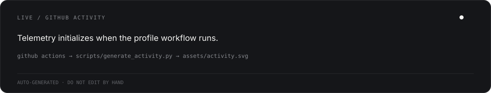

<p align="center">
  
</p>

<p align="center">
  <a href="https://brndndiaz.dev">portfolio</a>&nbsp;&nbsp;·&nbsp;&nbsp;
  <a href="https://www.linkedin.com/in/brandonwdiaz/">linkedin</a>&nbsp;&nbsp;·&nbsp;&nbsp;
  <a href="https://theeventoapp.com/">evento</a>
</p>

<br>

## `01 / currently shipping`

<table>
<tr>
<td width="58%" valign="top">

### EVENTO `● PRODUCTION`

Event infrastructure and ticketing built for real-world operations — from discovery and checkout to QR admission, organizer tooling and the infrastructure behind it.

`TypeScript` `Next.js` `Laravel` `PostgreSQL` `Redis` `Docker` `Cloudflare`

**[theeventoapp.com →](https://theeventoapp.com/)**

</td>
<td width="42%" valign="top">

### CARTE MAIL `◌ BUILDING`

**Mail that runs on your server.** A self-hosted mail platform focused on owning the infrastructure while keeping delivery practical.

`mail infrastructure` `self-hosting` `Docker` `PostgreSQL`

Private while it cooks.

</td>
</tr>
</table>

<br>

## `02 / what I actually work with`

```text
LANGUAGES      TypeScript · PHP · Go · JavaScript · Python · C#
FRONTEND       React · Next.js · React Native · Expo · Tailwind
BACKEND        Laravel · Node.js · Express · REST · WebSockets
DATA           PostgreSQL · Redis · MySQL · SQLite
INFRA          Docker · Linux · Cloudflare · Traefik · GitHub Actions
SECURITY       auth boundaries · network hardening · application security
```

I care more about **shipping complete systems** than collecting framework badges. Most of my work sits somewhere between product engineering, backend systems, infrastructure and the occasional security rabbit hole.

<br>

## `03 / developer telemetry`

<p align="center">
  
</p>

<sub>Generated from my public GitHub activity by a workflow in this repository. No third-party stats service.</sub>

<br>

## `04 / selected work`

| project | what it is | status |
| :-- | :-- | :-- |
| **Evento** | Event discovery, ticketing, payments, organizer operations and admission infrastructure. | `shipping` |
| **AssetTracer** | Asset-management tooling spanning web, backend and edge experiments. | `archive / previous work` |
| **WuzzleRush** | Public application project and one of the smaller things living outside the private-repo iceberg. | `public` |
| **Romero Architects** | Next.js web project. | `public` |

<sub>A lot of my current engineering work lives in private repositories. The profile is the map; the public repos are only part of the territory.</sub>

<br>

## `05 / after hours`

When I'm not shipping software, I'm usually producing music as **BRNDN D!AZ**, learning guitar, taking photos, or disappearing into a new technical sidequest.

```text
software  ────────────────────────────────●  infrastructure
music     ───────────────────────●           guitar
security  ───────────────────────────●       curiosity
```

<br>

---

<p align="center">
  <sub>BUILD / INFRASTRUCTURE / SECURITY / MUSIC</sub><br><br>
  <code>brxndxndiaz@github:~$ _</code>
</p>
