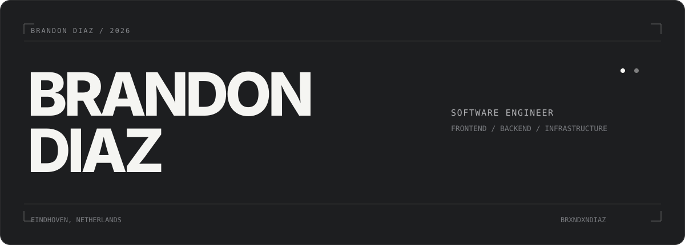
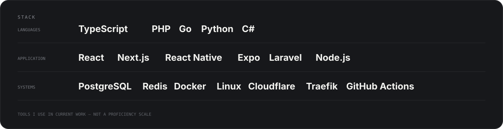

  

  <a href="https://brndndiaz.dev">brndndiaz.dev</a>&nbsp;&nbsp;&nbsp;·&nbsp;&nbsp;&nbsp;
  <a href="https://www.linkedin.com/in/brandonwdiaz/">LinkedIn</a>&nbsp;&nbsp;&nbsp;·&nbsp;&nbsp;&nbsp;
  <a href="mailto:info@brndndiaz.dev">Email</a>

Software engineer working across frontend, backend and infrastructure. Studying Software Engineering at Fontys and working part-time as a full-stack developer at Code for Good.

 

## Evento

  

Event ticketing platform for Aruba and Curaçao. I work across the application, API and infrastructure: event management, ticketing, payments, QR admission, organizer tooling, authentication, deployment and operations.

[theeventoapp.com →](https://theeventoapp.com/)

 

## Carte Mail

**Mail that runs on your server.** Self-hosted mail infrastructure, currently in development.

 

## Stack

  

 

## Outside software

**BRNDN D!AZ** — music production, piano, steelpan and guitar. Photography and video editing.
